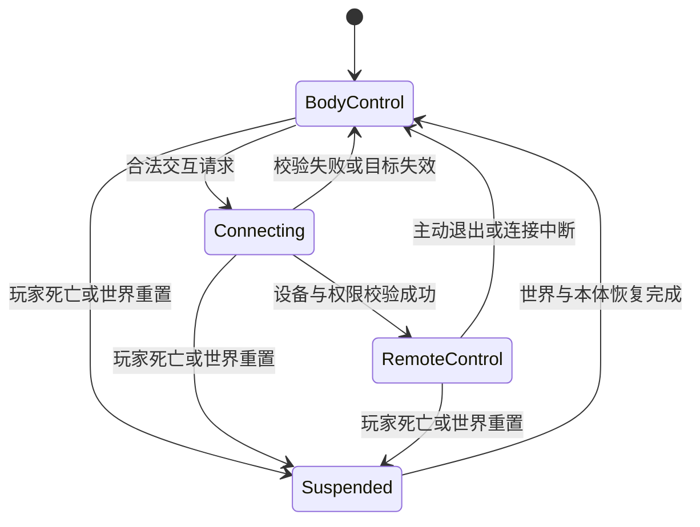

# 监控摄像机黑入

已确认范围是：关卡可配置监控设备，玩家能够黑入，切换到设备视角并操纵其方向，让设备朝向有利于自己的位置。权限、连接距离、警报和玩家本体状态尚未确定；下文为支撑原型闭环的建议，关联[待决策 D-03 至 D-07](../open-decisions.md)。

## 当前双入口范围

当前同时实现玩家正常黑入与 [GM 一键入侵](gm-prototype.md)。正常入口按选定方案校验交互距离与权限，GM 可跳过这些入口条件；两者共用本体／设备有效性、视角、转向、退出和中断处理。可玩原型还需用实际监控覆盖与路线变化验证转向价值。

下述终端、权限道具和警报后果是完整原型的具体建议，仍可按团队决定调整；正常可到达的交互入口和完整通路解谜属于当前目标。

## 正常交互方案建议

建议使用关卡终端选择一台固定关联的监控。玩家取得 `Item_CameraAccess` 后，在终端交互范围内发起连接；原型即时完成连接，不额外加入黑入小游戏、消耗品或冷却。关卡仍可放置多台设备，但一次只能操控一台，首个灰盒只要求一台。

黑入时显示设备标识、退出提示与转向边界反馈。视角来自监控所在位置，转动必须同时影响设备的观察方向和实际监控覆盖区。退出后玩家回到本体第一人称，设备保留本次调整的朝向，直至本阶段重置或其他明确事件改变它。

终端式入口只是 D-03 的推荐方案。若改为远距离瞄准设备黑入，需重新定义初次连接的射程、遮挡、目标选择与连接后的断开条件，避免把两套规则混用。

## 交互状态与退出路径

`Connecting` 可在一次交互内完成，但失败恢复路径仍须存在。死亡与重置具有最高退出优先级，远程操控不得阻止阶段系统重建世界。

| 路径 | 建议行为 |
| --- | --- |
| 正常进入 | 两入口均校验本体存活、世界可操作与设备有效；正常交互另校验选定的距离和权限规则，GM 可绕过该部分；通过后才转移输入 |
| 操控中 | 鼠标控制监控的水平与俯仰旋转；本体移动、射击、拾取输入停止 |
| 正常退出 | 断开控制关系，恢复进入前本体视角方向与输入，不把监控旋转复制给本体 |
| 设备销毁、禁用或卸载 | 本体仍存活时立即返回本体视角，并显示简短断开原因 |
| 本体死亡 | 交由阶段重置流程处理，禁止闪回已销毁本体或再次连接旧设备 |
| 连接过程中目标失效 | 恢复本体控制，不残留监控 UI 或输入模式 |
| 连续按进入或退出 | 同一状态变化只执行一次，不叠加连接和输入绑定 |

远程操控期间不会因为设备转开、不再看见终端而断线。初次交互范围和持续连接规则分开，建议首版无额外持续距离限制；设备失效、死亡或主动退出才结束连接（D-03）。

## 本体与时间建议

远程操控时，玩家本体留在原地，世界持续运行，本体停止主动移动与射击但仍能受伤和死亡（D-05）。普通受伤仅提供反馈，不强制断开；死亡一定断开。入口放在掩体后，确保学习操作时有合理安全窗口。

监控画面中的观察位置不能被敌人或警报系统当成玩家位置。敌人攻击与监控侦测均针对玩家本体。玩家用监控观察不会使角色实体瞬移，也不自动提供无敌状态。

## 朝向与侦测建议

| 配置 | 设计含义 |
| --- | --- |
| 稳定设备标识 | 区分设备并关联阶段配置、终端及调试记录 |
| 初始朝向 | 每个阶段重置后应用的朝向 |
| 水平与俯仰范围 | 相对安装基座的局部范围，避免穿墙、翻转或无限旋转 |
| 转向速度与灵敏度 | 可调参数，验证低帧率及不同输入设备下的可控性 |
| 观察视野 | 玩家通过设备能看到的画面范围 |
| 侦测视锥与距离 | 设备实际监控的范围，与画面视野的差异必须可理解 |
| 遮挡检查 | 墙和有效掩体应阻止发现本体 |
| 发现阈值 | 玩家进入覆盖区后触发警报所需条件；首版可采用短暂持续检测 |

不在文档阶段锁定具体角度、距离和速度。灰盒完成后根据通路宽度、终端位置及镜头遮挡调参，并记录实际测试值。角度边界以设备安装朝向为基准，不以世界零度为基准。

建议监控在黑入期间仍按当前朝向侦测。退出后保持人为设置的朝向，不自动回正、不恢复巡航；是否需要自动扫描见 D-04。设备模型、玩家看到的视角和侦测方向须使用同一转向结果，避免画面转了但逻辑仍监视旧方向。

## 警报与关卡反馈建议

当前可玩原型建议采用“发现本体后发出警报并锁住本轮通路”的规则（D-06），搭配可见警戒指示与通路状态变化。具体后果仍可调整；锁定后应提供清晰的死亡重试或主动重试入口，避免无法继续。

本轮警报锁定后，单纯把镜头转走不会清除已经发生的警报。循环重置后警报、门与发现进度一起恢复。后续可选择改为敌人增援、持续伤害或更柔性的失败反馈，但需同步调整关卡与测试。

验收必须对照两个情境：默认朝向能发现经过通路的本体；黑入转向并退出后，同一路径不再被该设备发现。单纯获得设备视角并不足以证明 R-09 已完成。

## 与循环系统的关系

监控操作默认属于循环内状态：本轮退出后保留朝向，死亡复活或 GM 跳阶段后恢复目标阶段的初始朝向。若采用权限道具方案，道具随 S1 重置并重新锁定终端；GM 可以绕过权限以便测试。永久黑入或跨循环改向属于额外设计，见 D-07。

若未来将“黑入指定设备”配置成关键条件，设备只报送事件，由阶段管理者决定是否标记待生效阶段；设备本身不直接推进阶段或重载世界。无论死亡发生在本体视角、连接中还是监控视角，均遵守同一套[阶段循环规则](stage-loop.md)。

## 建议输入与界面

进入与退出动作都应可绑定。原型可用交互键进入、独立返回键退出，鼠标控制方向；具体键位跟随现有输入方案，不在未检查模板绑定前覆盖已有动作。暂停菜单与退出监控使用不同意图，即使复用物理按键也要按当前状态正确分派。

正常游玩显示设备名、转向反馈、权限不足或连接中断原因及退出方式。阶段编号、设备标识、视锥和事件日志属于开发调试显示，不默认放入正式玩家界面。
