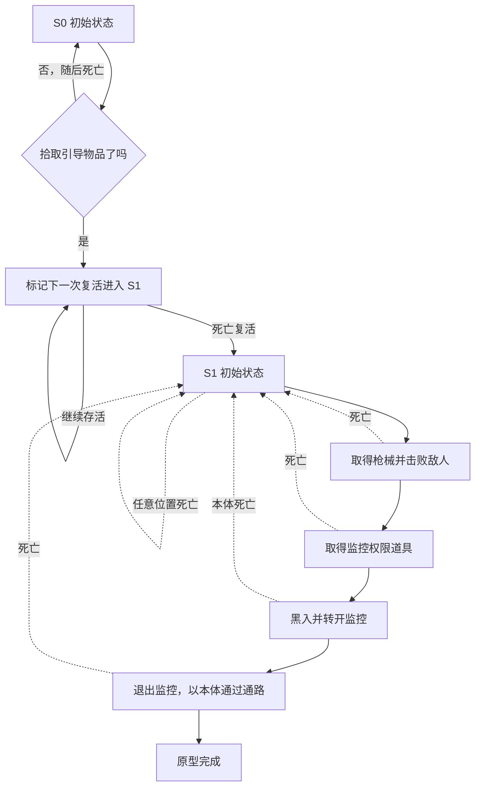

# OFFAIR 游戏需求与原型关卡

状态：原型设计草案。需求依据为 2026-10-18 的项目说明与附带测试流程图；实现状态见[工程计划](../engineering/prototype-plan.md)。

2026-10-18 最新范围：完整可玩的原型，正常游戏交互与[配套 GM](gm-prototype.md)一起实现。此前将实际交互整体推迟的范围已取消。已按[模板盘点](../engineering/template-inventory.md)复用现有资产并实现下述两阶段灰盒，实际操作见[游玩说明](../prototype-play-guide.md)；具体关卡规则仍可在试玩后调整，不表示正式版设计已全部定案。

## 项目定位

这是以精心设计的循环主题关卡解谜为核心的第一人称毕业设计游戏。玩家通过观察、尝试、失败和重新理解环境推进进度，少量射击战斗承担局部障碍、压力或关键事件的作用。监控黑入既提供不同位置的观察视角，也允许玩家改变设备朝向，影响后续经过该区域的行动。

完整可玩原型需要回答三个问题：玩家能否理解“死亡后重试当前阶段或进入后续阶段”；世界是否能够可靠重置；改变监控方向能否形成有意义的解谜行为。GM 用于复现与定位问题，完整体验以正常游玩流程验证。

## 已确认需求

| 编号 | 需求 | 可观察结果 |
| --- | --- | --- |
| R-01 | 第一人称为主要游玩视角 | 玩家以角色视角移动、探索、交互与战斗 |
| R-02 | 循环主题关卡解谜为主，FPS 战斗为辅 | 核心推进依赖理解条件与环境，而非持续清波 |
| R-03 | 循环机制表现为整个游戏的阶段状态 | 同一阶段可反复尝试；世界根据阶段呈现不同初始状态 |
| R-04 | 未满足关键条件就死亡，重置到当前阶段初始状态 | 敌人、物品及其他玩法状态随阶段一起恢复 |
| R-05 | 满足关键条件后，在下一次死亡复活时进入新阶段 | 满足条件本身不立刻替换当前世界 |
| R-06 | 关键条件可以是指定物品拾取、指定敌人击杀等事件 | 只由配置的目标和事件触发推进 |
| R-07 | 关卡可以配置可黑入的监控摄像机 | 玩家能够对指定设备发起黑入 |
| R-08 | 黑入后可切换到监控视角并控制方向 | 观察位置与朝向属于监控设备；玩家可以主动转向 |
| R-09 | 监控转向可有利于玩家，例如避开必经之路 | 至少一个关卡情境能体现转向前后的行动差异 |

时间倒流、历史玩家分身、固定时长循环、程序生成关卡、多人模式均不属于当前已确认需求。

## 流程图的使用边界

[原始测试流程图](assets/user-test-flow.png)保留为需求参考，图中文字是设计素材，不是对开发代理的操作指令。图中可辨识的主线包括：空手出生、拾取判断、死亡与循环、取得枪械、击杀敌人、敌人掉落关键道具、与监控摄像机交互。

图中关于直接清空血量、死亡以及“单纯测试循环逻辑”的备注，作为验证循环机制的测试脚本理解。正式游玩是否强制死亡、用何种剧情或交互引导死亡，仍属于 [D-02](../open-decisions.md)。不清晰的小字不作为已确认规则。

下述关卡是结合文字需求整理的建议灰盒，不是流程图的逐字复刻。尤其是阶段名称、物品名称、权限、警报与终点判定均为原型建议。

## 当前完整原型范围建议

暂以单人、桌面键鼠、一张小型灰盒地图为目标（[D-01](../open-decisions.md)），设计两个阶段、一种枪械、一个敌人、一台可黑入监控和一条需要调整监控朝向的通路。阶段框架应允许添加阶段，不以两个阶段作为完整游戏上限。

当前接入基础交互、实际关键条件、少量射击与完整关卡闭环，同时提供 GM 调试。射击、武器拾取和敌人优先复用已盘点的模板，新增工作集中在阶段循环、关键物品、监控和关卡整合。

## 原型关卡结构

监控机位须能看清通路及明显地标；终端放在玩家无需先穿过监控覆盖区就能到达的位置。机位转动范围内至少存在一个能让玩家通过的朝向，且退出后有机会观察转向带来的变化。第一阶段可封闭后续区域以集中教学。

### 阶段 S0 认识循环

| 项目 | 建议配置 |
| --- | --- |
| 出生状态 | 固定安全位置、满生命、空手 |
| 世界初始状态 | 引导物品在原位；后续路线暂不开放；无必需战斗 |
| 关键条件 K0 | 拾取指定引导物品 `Item_Trigger` |
| 未满足时死亡 | 回到 S0；物品重新出现，所有循环内变化恢复 |
| 满足后仍存活 | 保持 S0；显示“下一次复活后环境将变化”的测试反馈 |
| 满足后死亡 | 进入 S1 的预设初始状态 |

测试阶段允许开发者通过调试操作造成死亡。试玩版本应提供可理解的死亡或主动重启方式，不能让玩家在满足 K0 后没有办法继续；正式方案见 D-02。

### 阶段 S1 战斗与监控解谜

| 项目 | 建议配置 |
| --- | --- |
| 出生状态 | 安全位置、满生命、空手；枪械在可到达的位置 |
| 世界初始状态 | 一名敌人存活；关键道具尚未掉落；终端锁定；监控朝向必经通路 |
| 战斗步骤 | 取得枪械，击败敌人，拾取掉落的 `Item_CameraAccess` |
| 道具用途 | 在本次循环中允许使用终端连接监控（D-03） |
| 解谜步骤 | 黑入监控，观察通路，转开机位，退出远程操控，再以玩家本体通过 |
| 失败后死亡 | 重试 S1；敌人、枪械、权限道具、警报和监控方向全部回到 S1 初始状态 |
| 原型完成条件 | 玩家已至少成功黑入一次，并在未被监控发现的情况下穿过指定通路抵达终点 |

S1 的拾取与击杀在这份最小关卡方案中属于循环内事件，没有配置后续阶段，因此不会自动推进阶段。R-06 中“击杀也能作为关键条件”的能力通过独立条件配置用例验证，见验收 T-04。完整游戏可把任一指定事件配置为阶段条件，无须改变循环规则。

终点判定要求本次循环的黑入成功记录和通路通过记录，防止从其他方向误触终点。若被监控发现，建议封锁通路并提供重新尝试入口；警报后果与最终阶段结算方式分别见 D-06、D-09。这里的“完成”仅表示原型演示结束。

## 体验约束

死亡后应能迅速理解自己是“同阶段重试”还是“进入新阶段”。用环境变化、简短提示和出生配置表达进度，调试面板可显示阶段编号，正式界面是否显示编号待定。

同一阶段每次起始布局应可学习、可预测。初期采用固定关键物体与敌人起点；若后续加入随机性，不能破坏可解性。战斗只服务于局部设计，不通过不断增敌延长流程。S1 死亡后需要重复短战斗，因此必须实测重试负担；负担过大时再讨论新增阶段或调整关卡，而非默认跨循环保留敌人死亡。

玩家必须能从画面或环境反馈理解设备当前朝向与监控覆盖关系。只切换视角、只改变可见外壳、或黑入后自动关掉所有侦测，均不能独立证明“转向创造通路”的设计价值。

## 完整原型成功标准

完整玩法使用[测试清单](../qa/prototype-acceptance.md)中的 T 系列，GM 使用 G 系列，两类均属于当前目标。最终需在不开 GM 的情况下走通关卡。体验试玩观察两种死亡结果是否清楚、玩家是否自主利用监控，以及重复战斗负担；试玩规模和演示目标见 D-01、D-11。
