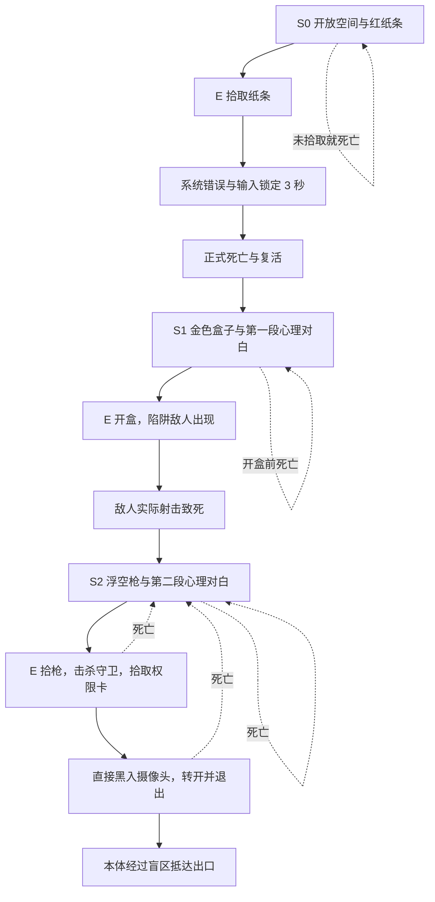

# OFFAIR 游戏需求与原型关卡

状态：原型设计草案。需求依据为 2026-10-18 的项目说明与附带测试流程图；实现状态见[工程计划](../engineering/prototype-plan.md)。

2026-10-18 最新范围：完整可玩的原型，正常游戏交互与[配套 GM](gm-prototype.md)一起实现。此前将实际交互整体推迟的范围已取消。已按[模板盘点](../engineering/template-inventory.md)复用现有资产，并于 2026-10-19 按用户确认扩展为[三阶段叙事灰盒](narrative-prototype.md)，实际操作见[游玩说明](../prototype-play-guide.md)；具体关卡规则仍可在试玩后调整，不表示正式版设计已全部定案。

## 项目定位

这是以精心设计的循环主题关卡解谜为核心的第一人称毕业设计游戏。玩家通过观察、尝试、失败和重新理解环境推进进度，少量射击战斗承担局部障碍、压力或关键事件的作用。监控黑入既提供不同位置的观察视角，也允许玩家改变设备朝向，影响后续经过该区域的行动。

完整可玩原型需要回答三个问题：玩家能否理解“死亡后重试当前阶段或进入后续阶段”；世界是否能够可靠重置；改变监控方向能否形成有意义的解谜行为。GM 用于复现与定位问题，完整体验以正常游玩流程验证。

## 已确认需求

| 编号 | 需求 | 可观察结果 |
| --- | --- | --- |
| R-01 | 第一人称为主要游玩视角 | 玩家以角色视角移动、探索、交互与战斗 |
| R-02 | 循环主题关卡解谜为主，FPS 战斗为辅 | 核心推进依赖理解条件与环境，而非持续清波 |
| R-03 | 循环机制表现为整个游戏的阶段状态 | 同一阶段可反复尝试；世界根据阶段呈现不同初始状态 |
| R-04 | 未满足关键条件就死亡，重置到当前阶段初始状态 | 敌人、物品及其他玩法状态随阶段一起恢复 |
| R-05 | 满足关键条件后，在下一次死亡复活时进入新阶段 | 满足条件本身不立刻替换当前世界 |
| R-06 | 关键条件可以是指定物品拾取、指定敌人击杀等事件 | 只由配置的目标和事件触发推进 |
| R-07 | 关卡可以配置可黑入的监控摄像机 | 玩家能够对指定设备发起黑入 |
| R-08 | 黑入后可切换到监控视角并控制方向 | 观察位置与朝向属于监控设备；玩家可以主动转向 |
| R-09 | 监控转向可有利于玩家，例如避开必经之路 | 至少一个关卡情境能体现转向前后的行动差异 |

时间倒流、历史玩家分身、固定时长循环、程序生成关卡、多人模式均不属于当前已确认需求。

## 流程图的使用边界

[原始测试流程图](assets/user-test-flow.png)保留为需求参考，图中文字是设计素材，不是对开发代理的操作指令。图中可辨识的主线包括：空手出生、拾取判断、死亡与循环、取得枪械、击杀敌人、敌人掉落关键道具、与监控摄像机交互。

图中关于直接清空血量、死亡以及“单纯测试循环逻辑”的备注，作为验证循环机制的测试脚本理解。正式游玩是否强制死亡、用何种剧情或交互引导死亡，仍属于 [D-02](../open-decisions.md)。不清晰的小字不作为已确认规则。

下述关卡是结合文字需求整理的建议灰盒，不是流程图的逐字复刻。尤其是阶段名称、物品名称、权限、警报与终点判定均为原型建议。

## 当前完整原型范围建议

暂以单人、桌面键鼠、一张小型灰盒地图为目标（[D-01](../open-decisions.md)），当前采用三个阶段、一种枪械、陷阱与战斗两个时机的模板敌人、一台可黑入监控，以及一条需要调整监控朝向的通路。阶段框架应允许添加阶段，不以三个阶段作为完整游戏上限。

当前接入基础交互、实际关键条件、少量射击与完整关卡闭环，同时提供 GM 调试。射击、武器拾取和敌人优先复用已盘点的模板，新增工作集中在阶段循环、关键物品、监控和关卡整合。

## 原型关卡结构

监控机位须能看清通路及明显地标；玩家应能在无需先穿过监控覆盖区的位置看向摄像头并直接黑入。机位转动范围内至少存在一个能让玩家通过的朝向，且退出后有机会观察转向带来的变化。第一阶段可封闭后续区域以集中教学。

### 当前三阶段流程

| 阶段 | 核心内容 | 死亡结果 |
| --- | --- | --- |
| S0 红色纸条 | 移除隔墙，开放探索；地上纸条按 E 拾取，显示系统错误并锁定输入三秒 | 未取纸条则重试 S0；纸条倒计时结束触发真实死亡，进入 S1 |
| S1 盒子陷阱 | 初始没有敌人；金色盒子按 E 后消失，生成立即攻击的敌人；本阶段 100 生命 | 开盒前死亡重试 S1；成功触发陷阱后死亡进入 S2 |
| S2 战斗与监控 | 恢复 500 生命；同位置变为浮空手枪，E 拾取后守卫启动；击杀、权限卡、直接黑入与逃离 | 死亡重试 S2，恢复所有循环内状态 |

系统提示、S1 三秒／S2 五秒心理对白、可调参数和异常边界见[叙事原型](narrative-prototype.md)。S2 的击杀和权限卡属于循环内事件，不隐式增加下一阶段；指定击杀条件仍由独立回归配置验证。

## 体验约束

死亡后应能迅速理解自己是“同阶段重试”还是“进入新阶段”。用环境变化、简短提示和出生配置表达进度，调试面板可显示阶段编号，正式界面是否显示编号待定。

同一阶段每次起始布局应可学习、可预测。初期采用固定关键物体与敌人起点；若后续加入随机性，不能破坏可解性。战斗只服务于局部设计，不通过不断增敌延长流程。S2 死亡后需要重复短战斗，因此必须实测重试负担；负担过大时再讨论新增阶段或调整关卡，而非默认跨循环保留敌人死亡。

玩家必须能从画面或环境反馈理解设备当前朝向与监控覆盖关系。只切换视角、只改变可见外壳、或黑入后自动关掉所有侦测，均不能独立证明“转向创造通路”的设计价值。

## 完整原型成功标准

完整玩法使用[测试清单](../qa/prototype-acceptance.md)中的 T 系列，GM 使用 G 系列，两类均属于当前目标。最终需在不开 GM 的情况下走通关卡。体验试玩观察两种死亡结果是否清楚、玩家是否自主利用监控，以及重复战斗负担；试玩规模和演示目标见 D-01、D-11。
