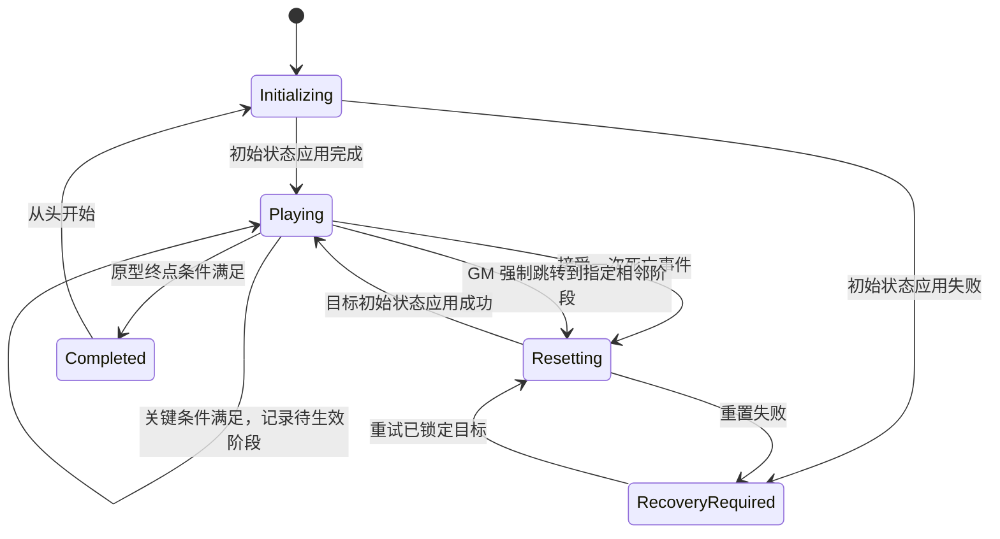

# 阶段循环与世界重置

本文件是阶段语义与重置边界的规范入口。R-03 至 R-06 为[已确认需求](game-design.md)；条件锁定、事件冲突及失败处理等细节采用下述原型建议，并在[待决策事项](../open-decisions.md)中保留确认入口。

当前真实拾取／击杀条件与 [GM 工具](gm-prototype.md)共同接入底层能力。正常死亡遵守以下核心规则；GM 前后阶段跳转可显式绕过条件立即重建目标阶段，属于开发测试例外，不改变正式玩法。

## 核心规则

1. 当前阶段决定本次循环使用的世界初始状态。
2. 未满足关键条件时死亡，使用当前阶段的初始状态重建世界。
3. 满足关键条件时，只记录待生效阶段；拾取、敌人死亡等事件自身仍照常改变当前世界。
4. 随后的死亡复活才让待生效阶段生效。新世界来自该阶段的预设初始状态，不来自达成条件或死亡瞬间的现场快照。
5. “整个世界重置”覆盖所有影响玩法的状态；不能只给玩家回血或只复活敌人。

当前三阶段方案见[叙事原型](narrative-prototype.md)：S0 拾取红色纸条后仍是 S0，按用户明确授权锁定输入并显示三秒系统错误，随后通过正式死亡进入 S1；S1 开盒并成功生成敌人后锁定 S2，实际死亡才推进。S2 使用独立初始状态，恢复正常生命、枪械与待机守卫。纸条自动死亡不表示条件事件直接切阶段。

## 原型状态模型

| 信息 | 含义与边界 |
| --- | --- |
| `CurrentStageId` | 当前生效的阶段；只有成功应用目标初始状态后才更新 |
| `PendingStageId` | 已满足关键条件后等待生效的阶段；未满足时为空 |
| `RunId` | 当前尝试的标识；每次成功出生或复活后更新，隔离旧尝试事件 |
| `RuntimeState` | `Initializing`、`Playing`、`Resetting`、`Completed` 或 `RecoveryRequired` |
| `ConditionState` | 当前尝试中条件所需的信息；通常随重置清除 |
| `ResetTargetStageId` | 本次重置锁定的目标阶段，重置期间不再改写 |

这些是职责与数据含义建议，不要求使用同名类。当前阶段、待生效阶段和单次循环不可合并为一个布尔量。

`PendingStageId` 为空和非空都属于 `Playing`；它不自动切地图、重置生命或触发死亡。`Completed` 是原型建议终态，见 D-09。

新游戏或“从头开始”先清除旧阶段进度，将配置的起始阶段 S0 设为初始化目标；初始化失败也保留这个目标以供重试。尝试标识须能区分新旧运行，不能因为从头开始又接受上一局的残留事件。

## 条件判定建议

- 条件由“事件类型 + 稳定目标标识 + 所属阶段”描述。例如 `ItemAcquired(Item_Trigger)` 或 `EnemyKilled(Enemy_Guard)`。其他敌人或同类普通物品不能误触发。
- 拾取事件在物品真正转移给玩家后产生；击杀事件在敌人真正死亡后产生。进入范围、瞄准、受伤均不等于完成事件。
- 条件一旦达成，建议在当前尝试中锁定；随后丢弃或消耗物品不撤销待生效阶段（D-07）。如果需要“死亡时仍持有”，应单独定义该类条件。
- 原型一次尝试最多推进一个阶段，尚未生效的新阶段不接收条件事件（D-08）。阶段图先采用线性链路；分支、回退、跨级和多个条件组合另行设计。
- 同一对象重复报送拾取或死亡事件，只生效一次。旧 `RunId`、重置期间、完成后的事件均不修改进度。
- 没有下一阶段的阶段不能因为任意关键事件隐式结束游戏。完成条件单独配置；引用不存在的下一阶段属于配置错误。

### 死亡与条件的冲突

建议按管理者接收的事件序列处理：关键事件在死亡被接受之前完成，则本次死亡进入下一阶段；死亡已被接受后到达的事件不再计入，即使它们发生在同一画面帧中（D-10）。不要仅用时间戳相等推断先后。

例如玩家发射弹丸后先死亡，旧弹丸随后击杀敌人，不得让重置中的目标阶段突然改变。实现应记录事件序号、阶段和 `RunId`，测试“先拾取后死亡”和“先死亡后拾取”两个顺序。若希望同帧互杀也算推进，需明确改成统一结算规则并更新测试。

## 阶段初始状态建议

初始状态是设计者配置的可重复起点。原型每个阶段至少配置：

| 配置项 | 内容 |
| --- | --- |
| 阶段标识与地图 | 唯一 `StageId`、原型地图、可选后续阶段 |
| 玩家配置 | 出生位置和方向、生命、武器、弹药、阶段固有权限 |
| 对象配置 | 稳定对象标识、存在与否、位置、门锁、敌人、拾取物及设备初始值 |
| 关键条件 | 事件类型、目标标识；无后续阶段时可不配置 |
| 摄像机配置 | 初始朝向、允许转动范围、权限与侦测参数 |
| 完成条件 | 原型终点或本阶段结束规则，与阶段推进条件分开 |

所有会影响通关的可变对象都必须能从基础地图与阶段配置得到明确起点。仅部分字段覆盖也可以，但每个未覆盖字段必须有明确的基础默认值，不能沿用上一次尝试的运行时值。

## 重置与保留边界

下表为原型建议（D-07）。跨循环保留仅表示同一次运行内，不代表退出游戏后自动存档。

| 状态 | 同阶段重试 | 进入后续阶段 |
| --- | --- | --- |
| 玩家位置、生命、武器、弹药 | 当前阶段初始值 | 后续阶段初始值，不复制死亡前背包 |
| 指定物品与普通拾取物 | 恢复该阶段存在与拾取状态 | 按后续阶段配置生成或隐藏 |
| 敌人生命、位置、死亡、掉落 | 恢复初始敌人与掉落规则 | 按后续阶段配置 |
| 敌人警戒、目标、巡逻进度 | 清除当前尝试状态，回到初始行为 | 按后续阶段配置 |
| 门、机关、电源、阻挡物 | 恢复初始开关与锁定状态 | 按后续阶段配置 |
| 监控方向、连接、黑入权限、警报 | 断开连接并恢复阶段初始值 | 断开连接并应用后续阶段初始值 |
| 掉落物、弹丸、临时生成物、临时效果 | 清除；由初始状态重新生成必要对象 | 同左 |
| 影响玩法的计时器、延迟回调、事件订阅 | 取消或隔离旧尝试，重新建立所需任务 | 同左 |
| 参与玩法的物理物体位置与速度 | 恢复初始变换，清除遗留速度 | 按后续阶段配置 |
| 阶段进度 | 当前阶段保留；无待生效阶段 | 成功应用后更新当前阶段、清空待生效阶段 |
| 玩家本人学到的信息 | 自然保留 | 自然保留 |
| 灵敏度、音量等用户设置 | 不属于世界重置范围 | 不属于世界重置范围 |

任何新增的跨循环道具、任务日志、知识标记或摄像机永久改向，都必须明确列出持久化规则，不能由某对象恰好未被销毁而意外保留。仅用于表现且不影响玩法的音效或粒子也应清理，避免复活后继续播放上一轮事件。

## 一次死亡重置的顺序建议

GM 跳转复用下述重建与提交过程：第 1 步改为接受有效 GM 跳转请求，第 2 步改用经校验的相邻阶段作为目标，其余清理与恢复步骤共用。原因记录为 GM 跳转，不伪造玩家死亡或关键条件事件。

1. 只在 `Playing` 接受一次有效玩家死亡；立即进入 `Resetting`，拒绝后续伤害、拾取、击杀与交互进度事件。
2. 将 `PendingStageId`（若存在）或 `CurrentStageId` 固定为 `ResetTargetStageId`，检查目标配置存在且有效。
3. 强制结束监控连接，解除输入路由与旧视角引用；遮蔽重建过程，冻结旧尝试的玩法更新。
4. 清理或隔离旧世界。实现方式见[工程方案](../engineering/prototype-plan.md)，优先保证全部状态恢复。
5. 从目标阶段初始状态建立世界、玩家和必要设备。初始化期间不接受玩法事件，AI 和交互尚不可用。
6. 检查出生点、必需对象、监控与输入控制可用；确认没有重复玩家、敌人或拾取物。
7. 成功后更新 `CurrentStageId`，清空 `PendingStageId` 和条件临时信息，更新 `RunId`，恢复本体第一人称与输入，进入 `Playing`。

重置调用应能防止重复执行。旧尝试的异步完成回调不能解锁输入、切回旧监控或改变新世界。

## 失败与恢复

若配置缺失、必需对象无法生成或初始化中断，保持在可恢复状态并显示失败原因；不要把半初始化世界交给玩家。目标阶段以及已达成的推进信息保留在会话级记录中，修复或重试仍使用同一目标，只有完整成功后才提交阶段变化。

“重新尝试当前阶段”如果对玩家开放，建议走与死亡相同的结算流程；“从头开始”则明确清除阶段进度。两者不能共用一个含义不明的“重置”按钮（D-02、D-12）。

若后来增加磁盘存档，应另行定义何时写入当前阶段和待生效阶段、损坏恢复与版本兼容。当前设计只要求同一次游戏运行内的阶段进度可靠，详见 D-12。
